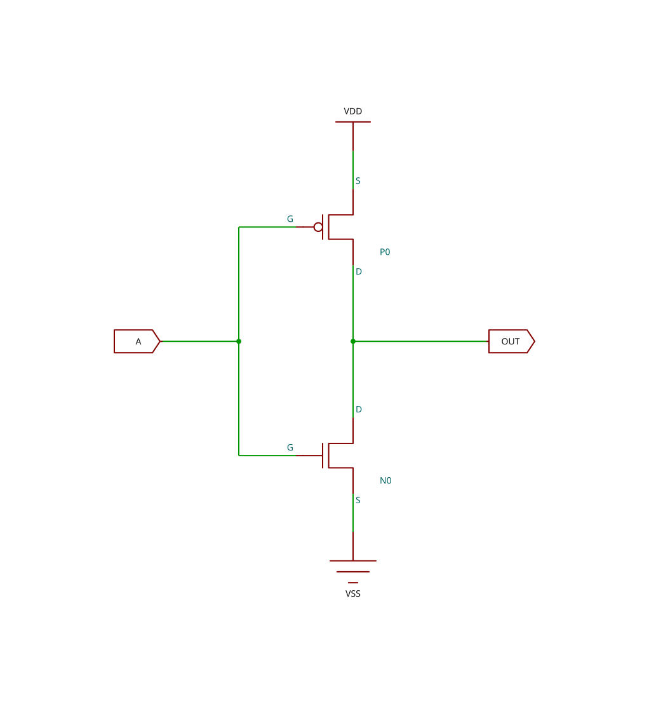
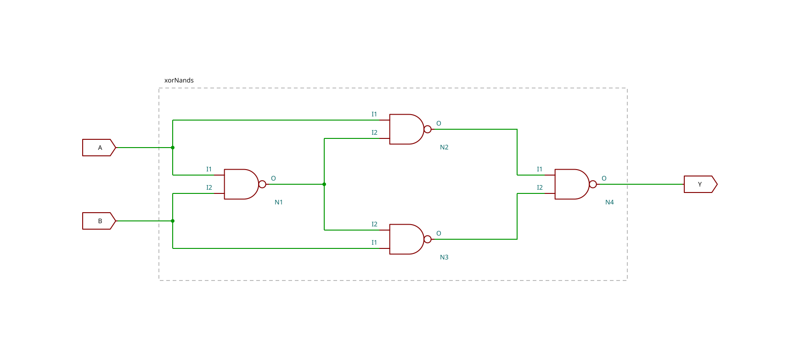

# infurnet-mermaid

Independently maintained Mermaid extensions, customizations, and plugins. Each npm workspace under `packages/` owns its implementation, public entry point, tests, examples, and documentation.

The first package, [mermaid-circuit](packages/mermaid-circuit/README.md), supports analog (`circuitDiagram A`) and digital (`circuitDiagram D`) circuit notation. It validates electrical connectivity, places devices, routes orthogonal wires, and renders SVG schematics. It also supports dynamic IC pins and three colour appearances: `default`, `default-inverse`, and `colored`.

Connectivity validation checks the diagram's devices, nets, and terminals; it is not electrical simulation or a physical safety check. See the package README for [supported behaviour](packages/mermaid-circuit/README.md#implemented-behavior) and [colour configuration](packages/mermaid-circuit/README.md#circuit-colours).

## Circuit examples

These saved SVGs are generated by the plugin and can be displayed in GitHub Markdown.

| CMOS inverter | Digital XOR using four NAND gates |
| --- | --- |
|  |  |
| [Mermaid source](packages/mermaid-circuit/examples/fixtures/cmos-inverter.mmd) | [Mermaid source](packages/mermaid-circuit/examples/fixtures/xor-nand4.mmd) |

The [Remote Control Trap](packages/mermaid-circuit/examples/remote-control-trap.md) shows a complete Markdown example with its schematic and source. Other examples include [CMOS NAND2](packages/mermaid-circuit/examples/fixtures/cmos-nand2.svg) and [twelve-transistor CMOS XOR](packages/mermaid-circuit/examples/fixtures/cmos-xor12.svg). The [example gallery](packages/mermaid-circuit/README.md#generated-circuit-examples) links all five circuits, their sources, and all three appearances.

## Develop and validate

Use Node.js 24.22.1 with its bundled npm. If Node is installed locally in `.venv/`, activate it from the repository root:

```sh
export PATH="$PWD/.venv/bin:$PATH"
export PLAYWRIGHT_BROWSERS_PATH="$PWD/.venv/browsers"
```

Install and validate from the repository root:

```sh
npm ci
npx playwright install chromium
npm run typecheck
npm run build
npm test
npm run test:browser
```

The browser suite uses real Chromium with Mermaid 12.2.0. CI installs Chromium's Linux system dependencies with `npx playwright install --with-deps chromium` and runs these checks. Type checking also builds the package so examples can resolve its compiled public exports.

Run a package independently with `npm run build --workspace mermaid-circuit`, `npm test --workspace mermaid-circuit`, or `npm run test:browser --workspace mermaid-circuit`.

## Extension APIs

Packages use the [public Mermaid API](https://mermaid.js.org/config/setup/mermaid/interfaces/Mermaid.html) appropriate to their extension:

| Extension | Host registration API |
| --- | --- |
| External diagram | `mermaid.registerExternalDiagrams()` |
| Icon pack | `mermaid.registerIconPacks()` |
| Layout loader | `mermaid.registerLayoutLoaders()` |

Only the circuit external-diagram integration is implemented here. There is no repository-specific registration wrapper.

After building, a consuming ESM application can register it:

```ts
import mermaid from 'mermaid';
import circuitDiagram from 'mermaid-circuit';

await mermaid.registerExternalDiagrams([circuitDiagram]);
mermaid.initialize({ startOnLoad: false });
const { svg } = await mermaid.render('circuit-example', 'circuitDiagram D');
document.getElementById('output')!.innerHTML = svg;
```

The host must load and register the package before rendering. GitHub Markdown, Mermaid Live Editor, and other hosts do not gain this diagram type unless they load the plugin.

## Add a package

After its ownership and scope are approved, add a directory under `packages/` with its own `package.json`, source, tests, examples, and README. The root `packages/*` workspace pattern discovers it. Provide `build`, `typecheck`, `test`, and `test:browser` scripts for the root commands, with browser validation appropriate to the package. Export compiled ESM and declarations through explicit package exports. Choose the Mermaid API that fits the extension; non-diagram packages do not need a diagram definition. Cross-package runtime dependencies require separate approval.
