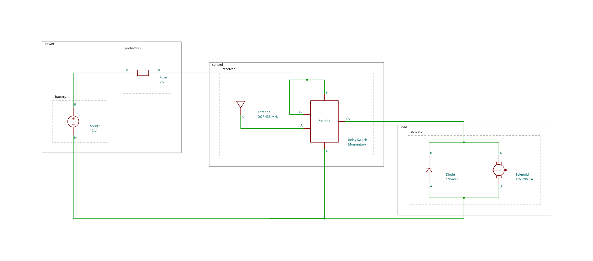

# Remote Control Trap

A simple 12 V wireless actuator for a humane live-animal trap, based on the Wildwood Flower project.

A 433 MHz remote activates a momentary relay, energizing a solenoid that releases the trap's mechanical latch. A flyback diode protects the relay contacts when the solenoid switches off.

## Disclaimer

**This is a schematic rendering example, not a validated construction plan or a safety certification.** The diagram does not verify component ratings, wiring, battery protection, mechanical design, or safe operation. A rendered connection does not establish that a physical build is safe or fit for use.

The example is provided **as is, without warranty**. Anyone who builds, modifies, or uses it assumes the risks and is responsible for independent review, testing, and safe operation. Errors or failures can cause fire, injury to people or animals, or property damage.

To the extent permitted by applicable law, the authors and contributors disclaim liability for loss, injury, or damage arising from use of this example. Obtain qualified electrical and mechanical review before building, and follow applicable rules for animal welfare and trapping. No claim of humane performance is made for any build based on this diagram.

## Circuit schematic



**Other themes:** [Monochrome](fixtures/wireless-solenoid.svg) · [Inverse](fixtures/wireless-solenoid-inverse.svg)

## Components

| Component | Specification |
| --- | --- |
| Power | Milwaukee M12 battery, 12 V |
| Controller | QIACHIP 433 MHz wireless relay |
| Actuator | uxcell 12 V, 20 N push-pull solenoid |
| Protection | Inline fuse and 1N5408 flyback diode |

The solenoid and diode are connected in parallel. The relay switches the positive supply to the solenoid while the receiver remains powered.

## Mermaid source

```text
circuitDiagram A
%% Owner circuit reference; physical module labels and ratings are not verified here.
subgraph block power
    subgraph stage protection
        Fuse["Fuse<br/>2A"]:::fuse
    end
    subgraph stage battery
        Source["Source<br/>12 V"]:::voltageSource
    end
end
subgraph block control
    subgraph stage receiver
        Remote["Relay Switch<br/>Momentary"]:::ic
        Antenna["Antenna<br/>OOF 433 MHz"]:::antenna
    end
end
subgraph block load
    subgraph stage actuator
        Diode["Diode<br/>1N5408"]:::diode
        Solenoid["Solenoid<br/>12V 20N 1A"]:::solenoid
    end
end
Source |P| --- |A| Fuse
Fuse |B| --- |v+| T:Remote
Fuse |B| --- |ctl| L:Remote
Antenna --- |A| L:Remote
Remote:B |v-| --- |N| Source
Remote:R |no| --- |A| Solenoid
Remote:R |no| --- |K| Diode
Solenoid |B| --- |N| Source
Diode |A| --- |N| Source
```

This diagram demonstrates dynamic IC pins, electrical net inference, parallel connections, stage grouping, and automatic schematic routing.

The SVG is generated by `mermaid-circuit`, allowing GitHub to display the diagram without native support for the custom `circuitDiagram` syntax.

---

<p>
  
  
</p>
