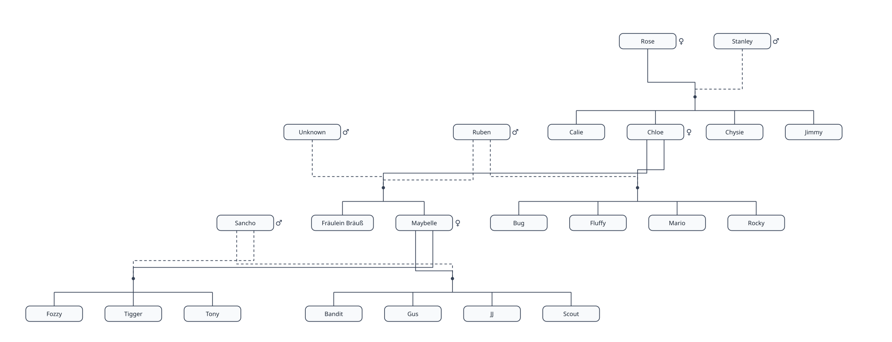

# Mermaid family tree

`mermaid-family-tree` adds feline pedigrees to Mermaid through its external
diagram API. It supports distinct litters, shared parents, uncertain sires,
confirmed individual parentage, generation spans, adoption, and optional portraits.

This is an unpublished source candidate. It uses the repository's npm workspace,
TypeScript, Vitest, Vite, and Playwright tooling. Runtime requirements and package
ownership are declared in `package.json` and the root [PROJECT.md](../../PROJECT.md).

## Register the diagram

Build the package from the repository root:

```sh
npm ci
npm run build --workspace mermaid-family-tree
```

In a consuming browser application:

```ts
import mermaid from 'mermaid';
import familyTree from 'mermaid-family-tree';

await mermaid.registerExternalDiagrams([familyTree]);
mermaid.initialize({ startOnLoad: false });

const source = `familyTree TB
    catmode
    Rose["Rose"]:::queen
    Stanley["Stanley"]:::tom
    subgraph L1["Litter 1"]
        Chloe
        Jimmy
    end
    Rose --> L1
    Stanley --> L1`;

const { svg } = await mermaid.render('colony', source);
document.getElementById('output')!.innerHTML = svg;
```

Hosts must load the plugin before rendering. The [notation specification](spec/notation.md)
defines supported Mermaid-style syntax, metadata, relationship semantics, and
diagnostics.

The [drawing specification](spec/style.md) defines geometry and
connector conventions. This package does not modify Mermaid core.

## Examples

| Example | Source | SVG |
| --- | --- | --- |
| Five-litter colony from Issue #24 | [Source](examples/fixtures/colony.mmd) | [Pedigree](examples/fixtures/colony.svg) |
| Distinct unknown queens | [Source](examples/fixtures/unknown-queens.mmd) | [Pedigree](examples/fixtures/unknown-queens.svg) |
| Confirmed paternity and human adoption | [Source](examples/fixtures/confirmed-adoption.mmd) | [Pedigree](examples/fixtures/confirmed-adoption.svg) |
| Ancestry across a generation gap | [Source](examples/fixtures/generation-gap.mmd) | [Pedigree](examples/fixtures/generation-gap.svg) |
| Explicit generation spans | [Source](examples/fixtures/generation-spans.mmd) | [Pedigree](examples/fixtures/generation-spans.svg) |
| Unknown generation spans | [Source](examples/fixtures/unknown-generation-spans.mmd) | [Pedigree](examples/fixtures/unknown-generation-spans.svg) |
| Portraits, plain nodes, and birth order | [Source](examples/fixtures/portraits.mmd) | [Pedigree](examples/fixtures/portraits.svg) |



The portrait example uses original illustrative cat artwork in `cat.svg`.
Keep that file beside the saved portrait SVG when viewing it standalone.
Preview all examples with `npm run dev --workspace mermaid-family-tree`.

For skipped or uncertain generations, see the
[generation-span notation](spec/notation.md#generation-spans). The
[conflicting-path example](examples/invalid/generation-conflict.mmd) demonstrates
a rejected graph; it has no rendered SVG.

The span examples include redundant shortcuts. Their intermediate lineage takes
precedence under [generation-gap resolution](spec/notation.md#generation-gap-resolution),
so those shortcuts draw no extra connector.

## Semantic graph and standalone rendering

```ts
import { parseFamily, layoutFamily, renderFamily } from 'mermaid-family-tree';

const family = parseFamily(source);
const layout = layoutFamily(family);
const svg = renderFamily(family, { id: 'exported-pedigree' });
```

`parseFamily` returns validated individuals, litters, and typed relationships.
`layoutFamily` returns node bounds, generations, litter rails, and connector
points.

`renderFamily` emits a standalone SVG without requiring a browser DOM.
Use a distinct `id` for each SVG that will share a document.

## Validate

Run from the repository root:

```sh
npm run typecheck --workspace mermaid-family-tree
npm run build --workspace mermaid-family-tree
npm test --workspace mermaid-family-tree
npm run test:browser --workspace mermaid-family-tree
npm run render:fixtures --workspace mermaid-family-tree
```

The browser suite needs the repository's Chromium installation. Tests verify
semantic identities, uncertainty, ancestry diagnostics, generation distances, sibling geometry,
portrait overlap, independent SVG IDs, deterministic output, and Mermaid
registration. Root validation commands include both diagram packages.

## Layout dependency

The implementation uses `d3-dag@1.2.2` under MIT. The
[dependency evaluation and notices](ACKNOWLEDGEMENTS.md) explain the switch from
`d3-pedigree-tree` and list the runtime licenses. Semantic interpretation and
final SVG rendering remain inside this package.

## Known limits

- Version 1 implements the notation subset listed in the specification, not
  the full flowchart language or general human genealogy.
- Layout follows biological constraints, not a calendar timeline. It does not
  infer ancestry from DNA.
- Large or densely interrelated colonies may have connector crossings and
  unused space. Sibling-row constraints can be incompatible with some graphs.
- Nameplate sizing estimates text width; it does not measure each host font.
- Portrait references depend on host URL access and image support. Saved SVG
  images may be restricted by embedding hosts.
- The current palette is fixed and does not follow Mermaid themes.

See [Issue #24](https://github.com/iamthenop/infurnet-mermaid/issues/24) for the
commissioned scope. No npm publication or release is implied by this source.
